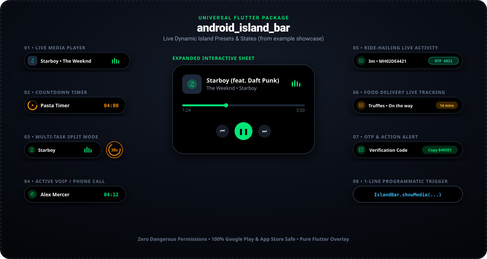

# android_island_bar

<p align="center">
  <a href="https://pub.dev/packages/android_island_bar"></a>
  <a href="https://pub.dev/packages/android_island_bar/score"></a>
  <a href="https://govindtank.github.io/android_island_bar/"></a>
  <a href="https://github.com/govindtank/android_island_bar"></a>
  <a href="https://github.com/govindtank/android_island_bar/blob/main/LICENSE"></a>
  <a href="https://buymeacoffee.com/govindtanko"></a>
  <a href="https://github.com/sponsors/govindtank"></a>
</p>

<p align="center">
  <strong>Universal cross-platform island overlay for Flutter (Android, iOS &amp; Web).</strong><br>
  Anchors to real Android DisplayCutout geometry, supports spring morphing and multi-task split bubbles, and stays inside the app window without overlay or accessibility access.
</p>

---

<p align="center">
  <a href="https://govindtank.github.io/android_island_bar/">
    
  </a>
</p>

<p align="center">
  🎮 <strong><a href="https://govindtank.github.io/android_island_bar/">Launch Live In-Browser Interactive Demo &amp; Cutout Simulator →</a></strong>
</p>

---

## 📱 Hardware Adaptation (Android &amp; iOS)

Unlike packages hardcoded to static coordinates, `android_island_bar` binds directly to physical device cutouts across operating systems:

* **Android Hardware Snapping:** Queries `WindowInsetsCompat.getDisplayCutout()` to automatically position, size, and mask the physical camera lens inside the black island pill. Supports **Center Punch-Holes** (Samsung Galaxy S/A/M, Motorola Edge), **Left Corner Cutouts** (Pixel, OnePlus), and **Teardrop Notches**.
* **iOS Dynamic Island Integration:** Auto-detects iPhone 14 Pro, 15, and 16 series (`safeAreaInsets.top >= 54pt`) to align pixel-perfect with Apple's physical Dynamic Island inside the app, and smoothly hugs the standard notch on iPhone X through 14.
* **Web &amp; Desktop Fallback:** Floats seamlessly as an unobtrusive top-center status pill below window insets.
* **Unified Single API:** Import `android_island_bar` and use either `IslandBar` or `AndroidIslandBar` across all targets with zero platform `if/else` checks.

---

## 🛠️ Real-World Production Scenarios

### 1. Streaming Audio &amp; Podcasts (Spotify / Apple Music Style)

Includes procedural equalizer visualizer bars that bounce when active, album scrub bar, and responsive controls.

```dart
IslandBar.showMedia(
  title: 'Starboy (feat. Daft Punk)',
  artist: 'The Weeknd',
  isPlaying: true,
  progress: 0.35,
  positionText: '1:24',
  durationText: '3:50',
  accentColor: const Color(0xFF00E676),
  onPlayPause: () => togglePlayPause(),
  onNext: () => skipNext(),
  onPrevious: () => skipPrevious(),
);
```

### 2. Active VoIP &amp; Phone Calls (WhatsApp / Cellular Style)

Displays caller avatar, ongoing duration counter, and quick mute / hangup actions. Higher priority ensures it retains primary island focus.

```dart
IslandBar.showCall(
  callerName: 'Alex Mercer',
  durationText: '04:12',
  isMuted: false,
  accentColor: const Color(0xFF00E676),
  onMuteToggle: () => toggleMute(),
  onEndCall: () {
    IslandBar.dismiss('active_call');
  },
);
```

### 3. Turn-by-Turn Rideshare &amp; Navigation (Uber / Maps Style)

Renders navigation maneuvers, remaining distance, and ETA chips in compact mode, expanding into an actionable route overview card.

```dart
IslandBar.showNavigation(
  destination: 'San Francisco Int Airport',
  etaText: '18 min',
  distanceText: '12.4 mi',
  nextInstruction: 'In 500 ft, Turn Right on 4th St',
  accentColor: const Color(0xFF00B0FF),
  onTap: () => openFullMap(),
);
```

### 4. Countdown Timers &amp; Pomodoro

Circular progress ring with tabular seconds countdown, pause/resume toggle, and cancel button.

```dart
IslandBar.showTimer(
  id: 'cooking_timer',
  label: 'Pasta Timer',
  remaining: const Duration(minutes: 4, seconds: 20),
  totalDuration: const Duration(minutes: 8),
  isPaused: false,
  accentColor: const Color(0xFFFF9100),
  onPauseResume: () => toggleTimer(),
  onCancel: () => IslandBar.dismiss('cooking_timer'),
);
```

### 5. OTA Downloads &amp; Background File Transfers

Linear progress indicator with byte velocity and percentage chip.

```dart
IslandBar.showProgress(
  id: 'firmware_ota',
  title: 'Firmware_v2.4.zip',
  subtitle: '48.2 MB / 114 MB • 4.2 MB/s',
  progress: 0.42,
  accentColor: const Color(0xFF29B6F6),
  onCancel: () => cancelDownload(),
);
```

### 6. Actionable Alerts &amp; OTP Autofill

Clean snackbar replacement with one-tap action chip (e.g. "Copy OTP") and configurable auto-dismiss.

```dart
IslandBar.showAlert(
  title: 'Verification Code',
  message: 'Your login code is 849201',
  actionLabel: 'Copy 849201',
  onAction: () => copyToClipboard('849201'),
  duration: const Duration(seconds: 5),
);
```

### 7. Multi-Tasking Concurrent Split Mode

When two activities are active simultaneously (e.g., Music playback + an active Timer), the island automatically splits into a **Dual Split Island**:
- The higher-priority task occupies the primary camera cutout pill.
- The secondary task attaches as a detached floating circular bubble on the opposite side.
- Tapping either bubble expands that specific task.

```dart
// Primary task (Music)
IslandBar.show(IslandItem.media(...));

// Pushing a second task automatically initiates Split Mode
IslandBar.push(IslandItem.timer(...));
```

---

## 🧲 Gestures &amp; Physics

* **Tap:** Expands the compact pill into an interactive control card.
* **Rubber-Band Drag Down:** Pulling down on the compact pill introduces fluid dampening resistance before snapping open with a spring curve.
* **Swipe Up:** Collapses the expanded sheet, or stashes the compact pill into the camera cutout.
* **Tactile Haptics:** Built-in `HapticFeedback.lightImpact()` fires upon expansion, collapse, and snap transitions.

---

## ⚡ Flux Island — Next-Gen Android Smart Island App

**Flux** is the changing stream of media, timers, and signals. **Island** is the calm anchor that keeps that stream glanceable.

### 🌟 Key Real-World Features & Youth Innovations:

1. **🎵 Universal Media HUD & Lo-Fi Sound Engine:**
   - Synchronizes seamlessly with active Android media players (Spotify, YouTube Music, Apple Music, Poweramp) via `MediaSessionManager`.
   - Built-in **4 Ambient Focus Soundscapes** (🌧️ Cyber Rainstorm, ☕ Midnight Tokyo Cafe, 🌊 Deep Space Drift, 🎧 Sunset Highway) with real-time procedural equalizer visualizer bars, progress scrubber, and full playback controls.

2. **⚡ Turbo Charge Fluid Surge HUD:**
   - Simulates 68W TurboPower liquid power surge with animated battery indicators, charging speed wattage, battery health, and thermal monitoring.

3. **📋 Magic Clipboard Drop (Context-Aware Intelligence):**
   - Automatically monitors copied text and pops a contextual action chip:
     - **URLs:** Direct 1-tap "Open in Chrome" & "Share".
     - **Color Hex (`#10B981`):** Live color swatch chip preview.
     - **2FA OTP Codes:** 1-tap clean paste button.
     - **Plain Text:** Text-to-speech speak aloud and word count analysis.

4. **🐾 Interactive Notch Pet (Viral Island Companion):**
   - Choose between **Mochi the Cat** (🐱), **Bolt the Pup** (🐶), **Cosmo the Alien** (👾), or **Spooky the Ghost** (👻) living right on the camera punch-hole.
   - Interactive gestures: tap to pet (heart particles burst), feed snacks 🐟, play ball 🎾, and sleep mode 💤.

5. **📐 Hardware Cutout Calibrator (Precision Pixel Tuner):**
   - Interactive visual tuner with sliders for Vertical Y-Offset, Horizontal X-Offset, Compact Min Width, and Pill Height.
   - Live real-time preview allowing users to hug punch-holes and notches on Motorola, Samsung, Pixel, and OnePlus devices down to the exact pixel.

6. **⏱️ Multi-Task Dual Split-Bubble Mode:**
   - Independent concurrent bubbles: active countdown timer in the left bubble and animated music visualizer or notch pet in the right bubble.

7. **🎨 5 Tailored Pro Palettes (OLED Contrast, Zero Dimness):**
   - **⚡ Cyber Lime:** OLED Pitch Black, Neon Lime (`#CBFF4D`), Electric Cyan (`#38D9F5`).
   - **🌌 Tokyo Night:** Deep Indigo, Neon Purple (`#A78BFA`), Ice Blue (`#60A5FA`).
   - **🌅 Sunset Glow:** Obsidian, Hot Coral (`#FB7185`), Warm Amber (`#FBBF24`).
   - **🍃 Matrix Emerald:** Pure Black, Toxic Mint (`#34D399`), Jade Glow.
   - **☀️ Ceramic Light:** Porcelain White (`#F4F6F9`), Deep Midnight Slate, Electric Cobalt.

8. **🔦 Quick Tools:**
   - Dynamic torch beam with brightness adjustment and emergency SOS strobe pulse.

### Run & Verify the Application

```bash
cd example
flutter pub get
flutter test
flutter run
```

### Android media access

Flux Island does not scrape notifications or use an overlay permission. On Android, the example declares a permission-gated `NotificationListenerService` so `MediaSessionManager` can read and control the active player. The user must enable **Flux Island media access** in Android notification access settings; turning it off disables the media feature.

---

## 🚀 Getting Started


Add `android_island_bar` to your `pubspec.yaml`:

```yaml
dependencies:
  android_island_bar: ^0.2.3
```

Wrap your root application inside `MaterialApp.builder`:

```dart
import 'package:flutter/material.dart';
import 'package:android_island_bar/android_island_bar.dart';

void main() => runApp(const MyApp());

class MyApp extends StatelessWidget {
  const MyApp({super.key});

  @override
  Widget build(BuildContext context) {
    return MaterialApp(
      builder: (context, child) {
        return IslandBarOverlay(
          alignment: CutoutAlignment.auto, // Auto-adapts to Android punch holes & iOS Dynamic Island
          child: child!,
        );
      },
      home: const HomeScreen(),
    );
  }
}
```

---

## 🎨 Theme Customization

Pass an `IslandTheme` to `IslandBarOverlay` to customize colors, spring curves, elevation, and paddings:

```dart
IslandBarOverlay(
  theme: const IslandTheme(
    backgroundColor: Color(0xFF000000), // Pitch-black OLED cutout masking
    contentColor: Color(0xFFFFFFFF),
    accentColor: Color(0xFF00E676),
    compactHeight: 38.0,
    expandedBorderRadius: 28.0,
    enableHaptics: true,
    springCurve: Curves.easeOutBack,
  ),
  child: child!,
);
```

---

## 🛡️ Policy &amp; Permissions

* **In-app overlay:** No `SYSTEM_ALERT_WINDOW` or Accessibility permission is required; the island is rendered inside the Flutter app window.
* **Media feature:** Android notification access is optional, explicitly enabled by the user, and required only to read/control active media sessions.
* **Honest data boundary:** Media metadata is read locally and is not uploaded by this plugin.

---

## ☕ Support &amp; Donations

If this library saves you time or powers your application, consider supporting ongoing development:

* **Buy Me A Coffee:** [buymeacoffee.com/govindtanko](https://buymeacoffee.com/govindtanko)
* **GitHub Sponsors:** [github.com/sponsors/govindtank](https://github.com/govindtank)

---

## 📄 License

MIT License. Copyright (c) 2026 Govind Tank.
